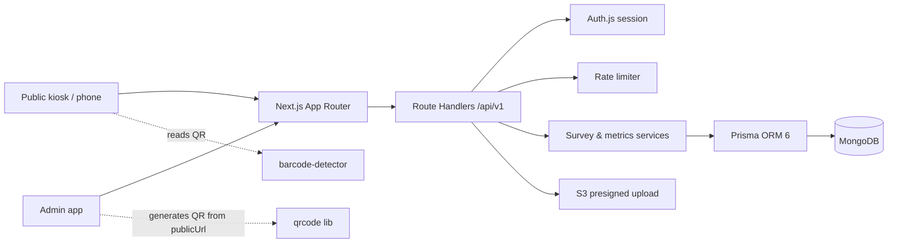
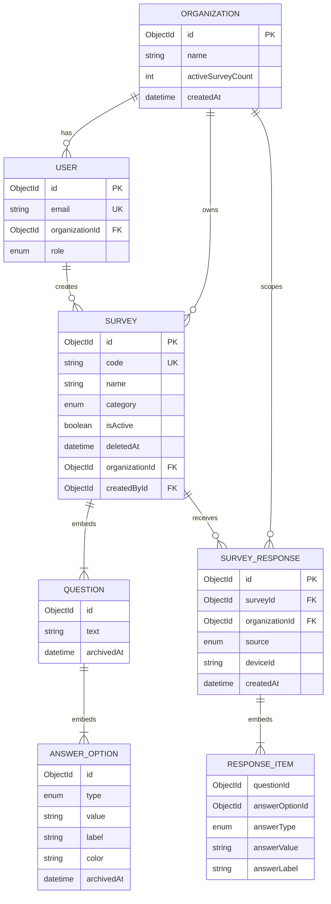

# Panda Metrics — Product & Technical Overview

Panda Metrics rebuilds the Kraquen surveys module as a standalone product. It is organized around three pillars: feedback collection (kiosk, link and QR), survey management, and reliable metrics. Every survey belongs to one of three categories: **Satisfaction** (faces), **Rating** (1 to 5 stars) or **Poll** (options defined by the creator).

The most important architectural decision is to keep Kraquen's MongoDB document model (questions and answer options embedded in the survey, responses referencing them by ObjectId) and manage it with Prisma ORM 6, the latest Prisma version with stable MongoDB support. That keeps historical data compatible while giving the project typed models and queries. On top of that model, Panda fixes the known data risks: options are archived instead of removed, responses carry a snapshot of the answer they chose, every query is scoped to an organization, and metrics are always calculated in the user's timezone.

Below is an implementation-oriented overview: architecture, Prisma models, metrics engine, API design, migration from Kraquen and a suggested development roadmap. The feature-level detail lives in `panda-metrics-project-spec.md`.

## 1. Product overview

**Feedback Collection**

A public kiosk where anyone can answer a survey in seconds: enter a code or scan a QR, tap one answer per question, see a thank-you screen and the survey restarts for the next person. Also works from a shared link on a phone.

**Survey Management**

Create, edit, activate and retire surveys in three categories (Satisfaction, Rating, Poll). Each survey gets a 6-character code, a public link and a downloadable QR.

**Metrics & Insights**

Per-question results by date range, timezone and day of week, for active and closed surveys. Trends over time and CSV export.

### Survey categories

| Category | What the respondent sees | Answer options | Main metric |
| -------- | ------------------------ | -------------- | ----------- |
| Satisfaction | Faces (Kraquen's reaction design) | The 5 reactions `VERY_BAD` … `INCREDIBLE`, labels and colors editable | Distribution per face |
| Rating | 1 to 5 stars | Fixed 5 options, values `1` … `5`, generated by the backend | Average score and distribution per star |
| Poll | Option cards with text or image | 2 to 5 options defined by the creator | Count and share per option |

The category is chosen when the survey is created and can only change while the survey has no responses.

### Target users

| User                   | Primary need                                                      |
| ---------------------- | ----------------------------------------------------------------- |
| Survey owner / manager | Create surveys, share link and QR, check results                  |
| Respondent (anonymous) | Answer quickly on a kiosk, tablet or phone, without an account    |
| Kiosk operator         | Leave a tablet running unattended in fullscreen                   |
| Analyst / admin        | Compare surveys over time, export data, review closed surveys     |

### Product principles

- Frictionless answering: no account, one tap per question, large touch targets.
- Unattended kiosk: it must recover on its own (restart, fullscreen, errors) without staff.
- Accurate metrics: counts are calculated deterministically from stored responses, in the viewer's timezone.
- History is immutable: editing a survey never rewrites or silently drops past answers.
- Private by organization: users only see and change their organization's surveys and responses.

## 2. Recommended MVP scope

Phase 1 — Public kiosk

Code entry, QR scanning on every browser, one-question-at-a-time runner with faces, stars and option cards, thank-you and auto-restart, fullscreen recovery, distinct not-found / inactive states.

Phase 2 — Survey management

Auth and organizations, survey CRUD with category picker (Satisfaction, Rating, Poll), poll image upload, QR and public link panel, 5-active limit, history list.

Phase 3 — Metrics

Dashboard with date range, timezone, day-of-week and category filters, rating averages, per-survey metrics for inactive surveys, time series and CSV export.

Phase 4 — Migration and hardening

Kraquen data migration, redirect for printed QR codes, rate limiting, i18n completeness, accessibility and device testing.

The kiosk comes first because it is the highest-value piece, it does not depend on auth, and it can be tested against seeded surveys. Metrics come after the data model (snapshots, archiving, organization scope) is stable, so the queries are written once.

## 3. Technical architecture

Recommended stack:

| Layer          | Technology                              | Responsibility                                        |
| -------------- | --------------------------------------- | ----------------------------------------------------- |
| Frontend       | Next.js (App Router) + React            | Admin app, public kiosk, layouts                      |
| Language       | TypeScript                              | Type safety across frontend and backend               |
| UI             | shadcn/ui (latest) + Radix primitives   | Accessible components copied into the project; Kraquen's faces, stars and cards rebuilt on top |
| Styling        | Tailwind CSS v4                         | CSS-first theme (`@theme` in `globals.css`), design tokens, dark mode |
| Data fetching  | TanStack Query                          | Queries, mutations, cache and loading states          |
| Forms          | react-hook-form + Zod                   | Survey editor; Zod schemas shared with the API        |
| Database       | MongoDB (Atlas, replica set)            | Organizations, users, surveys and responses           |
| ORM            | Prisma ORM 6 (MongoDB connector)        | Data models, queries and schema sync                  |
| Authentication | Auth.js / NextAuth v5 (Prisma adapter)  | Sessions, credentials and organization-scoped roles   |
| Storage        | Amazon S3 (Panda bucket)                | Answer images via presigned URLs                      |
| QR             | `barcode-detector`, `qrcode`            | Read QR on every browser; generate QR on the client   |
| i18n           | next-intl                               | Spanish and English                                   |
| Deployment     | Next.js-compatible hosting              | App and API route handlers                            |

Useful official documentation:

- [Next.js documentation](https://nextjs.org/docs)
- [Prisma ORM with MongoDB](https://www.prisma.io/docs/orm/overview/databases/mongodb)
- [MongoDB documentation](https://www.mongodb.com/docs/)
- [Auth.js documentation](https://authjs.dev/)
- [shadcn/ui documentation](https://ui.shadcn.com/docs)
- [Tailwind CSS documentation](https://tailwindcss.com/docs)
- [TanStack Query documentation](https://tanstack.com/query/latest)
- [React Hook Form documentation](https://react-hook-form.com/)
- [Zod documentation](https://zod.dev/)
- [next-intl documentation](https://next-intl.dev/)
- [barcode-detector (npm)](https://www.npmjs.com/package/barcode-detector)
- [qrcode (npm)](https://www.npmjs.com/package/qrcode)

### System architecture



Data flow rules

1. Public kiosk endpoints (`/public/:code`) are the only unauthenticated routes. They return a reduced survey and only work for active surveys.
2. Every authenticated operation validates the session and the organization of the survey before reading or changing it.
3. Metrics are calculated on the server with MongoDB aggregation pipelines, always with an explicit timezone. The client never computes counts.
4. Request bodies are validated with the same Zod schemas the frontend uses.
5. Database credentials, S3 keys and auth secrets stay on the server.
6. `publicUrl` is derived from `PANDA_PUBLIC_URL`; the QR is generated on the client. Neither is stored.

## 4. Data model and database design

### Core design decisions

- Each survey has a `category` (`SATISFACTION`, `RATING`, `POLL`); the type of its answer options must match it (`REACTION`, `RATING`, or `TEXT` / `IMAGE`).
- Kraquen's document model is kept: questions and answer options are embedded in the survey (Prisma composite types), and each response embeds its items. Ids stay as MongoDB ObjectIds.
- Embedded questions and options carry their own ObjectId, generated by the service. Those ids are what responses reference, so they are never regenerated on update.
- Questions and answer options are **archived** (`archivedAt`), never removed from the array, once they exist. Editing a survey keeps the ids of unchanged items; removed items are archived so their past answers still resolve.
- Each response item stores a snapshot (`answerType`, `answerValue`, `answerLabel`) of the chosen option, so relabeling an option never rewrites history.
- A response answers each question at most once (validated by the API, since embedded arrays cannot carry a unique index).
- Every survey and response belongs to an organization; responses denormalize `organizationId` for fast queries.
- Surveys are soft deleted (`deletedAt`); their responses are kept.
- Responses are immutable: `createdAt` only.
- `publicUrl`, QR image, `totalResponses`, `totalAnswers` and per-option `count` are computed, never stored.

### Entity relationship diagram



`QUESTION`, `ANSWER_OPTION` and `RESPONSE_ITEM` are embedded documents (composite types), not collections.

## 5. Prisma ORM schema (MongoDB)

Prisma ORM 7 does not support MongoDB yet, so the project uses **Prisma ORM 6** with the MongoDB connector (MongoDB support in Prisma 8 is in early access; upgrading is a later decision). The following is a proposed baseline, including the models needed by the Auth.js Prisma adapter. It is designed for organization-scoped data (one organization per user).

File: `prisma/schema.prisma`

```prisma
generator client {
  provider = "prisma-client-js"
}

datasource db {
  provider = "mongodb"
  url      = env("DATABASE_URL")
}

enum Role {
  OWNER
  ADMIN
  MEMBER
}

enum SurveyCategory {
  SATISFACTION
  RATING
  POLL
}

enum AnswerType {
  REACTION
  RATING
  TEXT
  IMAGE
}

enum ResponseSource {
  KIOSK
  LINK
  QR
}

model Organization {
  id                String   @id @default(auto()) @map("_id") @db.ObjectId
  name              String
  activeSurveyCount Int      @default(0)
  createdAt         DateTime @default(now())
  updatedAt         DateTime @updatedAt

  users     User[]
  surveys   Survey[]
  responses SurveyResponse[]
}

model User {
  id             String    @id @default(auto()) @map("_id") @db.ObjectId
  name           String?
  email          String?   @unique
  emailVerified  DateTime?
  image          String?
  passwordHash   String?
  role           Role      @default(MEMBER)
  organizationId String?   @db.ObjectId

  organization Organization? @relation(fields: [organizationId], references: [id])
  accounts     Account[]
  sessions     Session[]
  surveys      Survey[]

  createdAt DateTime @default(now())
  updatedAt DateTime @updatedAt

  @@index([organizationId])
}

model Account {
  id                String  @id @default(auto()) @map("_id") @db.ObjectId
  userId            String  @db.ObjectId
  type              String
  provider          String
  providerAccountId String
  refresh_token     String?
  access_token      String?
  expires_at        Int?
  token_type        String?
  scope             String?
  id_token          String?
  session_state     String?

  user User @relation(fields: [userId], references: [id], onDelete: Cascade)

  @@unique([provider, providerAccountId])
}

model Session {
  id           String   @id @default(auto()) @map("_id") @db.ObjectId
  sessionToken String   @unique
  userId       String   @db.ObjectId
  expires      DateTime

  user User @relation(fields: [userId], references: [id], onDelete: Cascade)
}

model VerificationToken {
  id         String   @id @default(auto()) @map("_id") @db.ObjectId
  identifier String
  token      String   @unique
  expires    DateTime

  @@unique([identifier, token])
}

type AnswerOption {
  id         String     @map("_id") @db.ObjectId
  type       AnswerType
  value      String
  label      String
  color      String     @default("")
  archivedAt DateTime?
}

type Question {
  id         String         @map("_id") @db.ObjectId
  text       String
  options    AnswerOption[]
  archivedAt DateTime?
}

model Survey {
  id             String         @id @default(auto()) @map("_id") @db.ObjectId
  organizationId String         @db.ObjectId
  createdById    String         @db.ObjectId
  code           String         @unique
  name           String
  description    String         @default("")
  category       SurveyCategory
  isActive       Boolean        @default(false)
  questions      Question[]
  deletedAt      DateTime?
  createdAt      DateTime       @default(now())
  updatedAt      DateTime       @updatedAt

  organization Organization     @relation(fields: [organizationId], references: [id])
  createdBy    User             @relation(fields: [createdById], references: [id])
  responses    SurveyResponse[]

  @@index([organizationId, isActive])
  @@index([organizationId, category])
}

type ResponseItem {
  questionId     String     @db.ObjectId
  answerOptionId String     @db.ObjectId
  answerType     AnswerType
  answerValue    String
  answerLabel    String
}

model SurveyResponse {
  id             String         @id @default(auto()) @map("_id") @db.ObjectId
  surveyId       String         @db.ObjectId
  organizationId String         @db.ObjectId
  items          ResponseItem[]
  source         ResponseSource
  deviceId       String?
  locale         String?
  durationMs     Int?
  createdAt      DateTime       @default(now())

  survey       Survey       @relation(fields: [surveyId], references: [id])
  organization Organization @relation(fields: [organizationId], references: [id])

  @@index([surveyId, createdAt(sort: Desc)])
  @@index([organizationId, createdAt(sort: Desc)])
}
```

### Important schema notes

**MongoDB requirements:** Prisma's MongoDB connector needs a replica set (MongoDB Atlas provides one; locally, run a single-node replica set). Relations between collections are emulated by Prisma, not enforced by MongoDB.

**Embedded ids:** composite types do not generate ids, so the service creates them with `new ObjectId().toHexString()` (from `bson`) for every new question and option.

**Authentication:** the schema includes the Auth.js adapter models in their MongoDB form. Email/password requires password hashing (`passwordHash`, never plaintext), credential validation and account recovery. Credentials-based Auth.js generally requires JWT sessions, so the session strategy must be configured consistently. Organization and role go into the session so every service can scope queries.

**Category rules:** Prisma enforces the enums, but the rules that tie options to the survey category are validated with a Zod discriminated union on `category` in the service layer:

- `SATISFACTION`: only `REACTION` options, values in `VERY_BAD` … `INCREDIBLE`, no duplicates, 1 to 5 per question (default all 5).
- `RATING`: exactly 5 `RATING` options with values `1` … `5`. The backend generates them; the client only sends the question text.
- `POLL`: 2 to 5 `TEXT` or `IMAGE` options; image values must be http(s) URLs.

Changing `category` is rejected once the survey has responses (`409`), because past metrics would no longer make sense.

**Active-survey limit:** "Max 5 active surveys" is enforced with an atomic counter on the organization. Activating a survey runs, inside `prisma.$transaction`, `organization.updateMany({ where: { id, activeSurveyCount: { lt: 5 } }, data: { activeSurveyCount: { increment: 1 } } })`; if it updates 0 documents the limit is reached (`409`). Deactivating or deleting an active survey decrements the counter. Two concurrent requests cannot create a sixth active survey.

**Preserving ids on update:** the update service merges questions and options by `id` and writes the whole `questions` array back. Items without `id` get a new ObjectId; items omitted from the payload stay in the array with `archivedAt` set. Retyping an option that has answers creates a new option and archives the old one.

**Answer integrity:** the public submit service checks that each `answerOptionId` belongs to the given `questionId`, that the question belongs to the survey and is not archived, and that no question appears twice; then it copies `type`, `value` and `label` into the item snapshot.

**Code generation:** generate random A-Z0-9 codes, reject reserved tokens (`SURVEY`, `PUBLIC`, `PANDA`) and retry on the unique-index error (`P2002`).

**Soft delete:** every survey query filters `deletedAt: null` (Prisma on MongoDB also treats a missing field as `isSet: false`, so filter with `OR: [{ deletedAt: null }, { deletedAt: { isSet: false } }]` for imported documents).

### Prisma client

File: `src/server/prisma.ts`

```ts
import { PrismaClient } from '@prisma/client';

const globalForPrisma = globalThis as unknown as { prisma?: PrismaClient };

export const prisma = globalForPrisma.prisma ?? new PrismaClient();

if (process.env.NODE_ENV !== 'production') globalForPrisma.prisma = prisma;
```

### Schema and data changes

Prisma Migrate does not support MongoDB. Schema changes (collections and indexes) are applied by syncing the committed schema:

```bash
# Sync collections and indexes with the schema
npx prisma db push

# Regenerate the Prisma Client when needed
npx prisma generate

# Inspect the database during development
npx prisma studio
```

Changes to existing data (renaming fields, backfills, the Kraquen import) are versioned scripts in `scripts/data/`, reviewed and committed, run in dev first and then in prod.

## 6. Metrics engine

Metrics are computed deterministically from `SurveyResponse` with a MongoDB aggregation pipeline, run through `prisma.surveyResponse.aggregateRaw`. The client only renders the results.

Inputs: survey (or all active surveys of the organization), date range `gte` / `lt` as `YYYY-MM-DD`, IANA timezone, optional `daysOfWeek`.

Per-option counts:

```ts
// from / to: UTC instants of local midnight for gte / lt in `timezone`
const rows = await prisma.surveyResponse.aggregateRaw({
  pipeline: [
    {
      $match: {
        surveyId: { $oid: surveyId },
        createdAt: { $gte: { $date: from.toISOString() }, $lt: { $date: to.toISOString() } },
      },
    },
    ...(isoDays.length
      ? [{ $match: { $expr: { $in: [{ $isoDayOfWeek: { date: '$createdAt', timezone } }, isoDays] } } }]
      : []),
    { $unwind: '$items' },
    {
      $group: {
        _id: { question: '$items.questionId', option: '$items.answerOptionId' },
        count: { $sum: 1 },
      },
    },
  ],
});
```

Steps:

1. Convert `gte` / `lt` to UTC instants at local midnight in the given timezone, and `daysOfWeek` to ISO days (1 = Monday … 7 = Sunday).
2. Run the pipeline above.
3. Load the survey's questions and options, including archived ones.
4. Merge counts into the active options, returning `count: 0` for options without answers. For Rating surveys, also return the average per question.
5. Archived options that have answers in the range are returned flagged as removed (using their stored label), so they never disappear silently.

Definitions:

- `count(option)` = number of response items with that option
- `totalAnswers(question)` = sum of `count` over the question's options
- `share(option)` = `count / totalAnswers` (0 when `totalAnswers` is 0)
- `average(question)` (Rating only) = `Σ(value × count) / totalAnswers`, rounded to 1 decimal
- `totalResponses(survey)` = number of `SurveyResponse` documents in the range (not the max of `totalAnswers`, which undercounts when submissions are partial)

Time series use the same match stages and group by `{ $dateToString: { format: '%Y-%m-%d', date: '$createdAt', timezone } }`.

Test with responses near midnight in different timezones, with `daysOfWeek` filters, with archived options and with partial submissions.

## 7. Public kiosk

The kiosk is a small state machine rather than a set of independent flags:

```
codeEntry → loading → (notFound | inactive | answering) → submitting → thanks → tapToStart → answering
```

Rules:

- **Code parsing** accepts a bare code, a URL with `?code=`, or any text containing a valid 6-character code. It never throws on text that is not a URL.
- **QR scanning** uses `barcode-detector` so it works on Safari and Firefox. The camera stream and scan interval are released when the screen unmounts.
- **Answer UI by category:** faces for Satisfaction, a row of 5 stars for Rating (hover/tap fills up to the chosen star), option cards with text or image for Poll. Keys `1`-`5` select a face, star or option.
- **Answering:** one question at a time, 700 ms slide/fade with no overlap, progress bar, back/forward navigation, keyboard shortcuts (`1`-`5`, `Enter`, `↑`/`↓`).
- **Submitting** is ignored while a submission is in progress (prevents Enter + click double submits).
- **Thanks:** a 5-second countdown, then the runner resets.
- **Fullscreen:** entered on code submit; after each restart a "Tap to start" screen re-enters fullscreen with a real user gesture, because browsers reject it otherwise.
- **Errors:** 404 and 400 have their own screens ("not found" vs "this survey is closed").
- **Metadata:** the kiosk sends `source`, a persistent `deviceId`, the UI `locale` and `durationMs` with each submission.

## 8. API and server-side operations

Use Next.js Route Handlers under `/api/v1`, with shared service functions for the business logic. All responses use `{ success, data }` or `{ success: false, error }`.

| Endpoint                                     | Method | Auth | Purpose                                              |
| -------------------------------------------- | ------ | ---- | ---------------------------------------------------- |
| `/api/v1/surveys`                            | GET    | Yes  | List surveys (`?active=true`, `?category=`, search, pagination) |
| `/api/v1/surveys`                            | POST   | Yes  | Create survey with `category`; Satisfaction / Rating options generated, Poll options required |
| `/api/v1/surveys/[id]`                       | GET    | Yes  | Survey detail with `publicUrl`                       |
| `/api/v1/surveys/[id]`                       | PUT    | Yes  | Partial update, merging questions and options by `id` |
| `/api/v1/surveys/[id]`                       | DELETE | Yes  | Soft delete                                          |
| `/api/v1/surveys/dashboard`                  | POST   | Yes  | Metrics for all active surveys                       |
| `/api/v1/surveys/[id]/metrics`               | GET    | Yes  | Metrics for any survey, active or not                |
| `/api/v1/surveys/[id]/metrics/timeseries`    | GET    | Yes  | Responses per day and per option                     |
| `/api/v1/surveys/[id]/responses/export.csv`  | GET    | Yes  | CSV export                                           |
| `/api/v1/surveys/public/[code]`              | GET    | No   | Reduced survey for the kiosk (404 / 400 inactive)    |
| `/api/v1/surveys/public/[code]/answers`      | POST   | No   | Submit `answers: [{ question, answer }]` by id       |
| `/api/v1/uploads/image`                      | POST   | Yes  | Presigned S3 URL for answer images                   |

The API keeps Kraquen's payload shape (nested `questions[].answers[]`); the services map it to the Prisma models (`questions[].options[]`, `items[]`).

Dashboard request body:

```json
{
  "date": {
    "filterBy": "custom",
    "timezone": "America/Mexico_City",
    "daysOfWeek": ["monday", "tuesday", "wednesday", "thursday", "friday"],
    "value": { "gte": "2026-10-01", "lt": "2026-10-13" }
  }
}
```

### API rules

1. Validate request bodies with the shared Zod schemas.
2. Require an authenticated user for every non-public route.
3. Check that the survey belongs to the user's organization before reading or changing it; return 404 (not 403) for other organizations' ids.
4. Enforce the 5-active limit atomically on create and on inactive → active.
5. Use `prisma.$transaction` for multi-step changes (activation with the active-survey counter, delete of an active survey).
6. On public submit, check that every `question` / `answer` id belongs to the survey, reject duplicated questions and store the snapshot.
7. Rate limit public submissions by IP and `deviceId`, and rate limit auth endpoints.
8. Return consistent status codes: 400 validation / inactive, 401 unauthenticated, 404 not found, 409 active limit, 429 rate limited.

## 9. Migration from Kraquen

Only applies if historical data is moved (see Open Decisions). It is a versioned data script in `scripts/data/`, run first against a copy of production data. Since both sides are MongoDB, ObjectIds are kept as they are.

1. Read Kraquen's `Survey` and `SurveyClientAnswer` collections.
2. Write each survey into Panda's `Survey` collection with the **same `_id`**, keeping the `_id` of every question and option (renaming `question` → `text` and `answers` → `options`).
3. Remap `createdBy` with a `kraquenUserId → pandaUserId` table and set `organizationId` on surveys and responses; recompute `activeSurveyCount` per organization.
4. Set `category`: surveys whose options are all reactions become `SATISFACTION`; any other survey becomes `POLL`, and its reaction options become `TEXT` options keeping label and color (Kraquen has no star ratings).
5. Write each client answer as a `SurveyResponse` with the same `_id`, `source: KIOSK` (origin unknown) and one item per answer, filling the snapshot from the current option.
6. Answers that point to options that no longer exist get an archived option added to that question with `label: '(deleted)'`, so every item still resolves.
7. Copy answer images to Panda's S3 bucket and rewrite the option `value`.
8. Drop the stored `qr` field (QR is generated on the client).
9. Keep every `code` and redirect `app.kraquen.io/survey?code=X` to `<panda>/s?code=X` so printed QR codes keep working.
10. Validate by comparing per-option counts on both dashboards for the same range, timezone and days of week.

## 10. UI/UX specification

### Main navigation

```
Panda Metrics            [ Search surveys…  ⌘K ]          [ + New survey ]

  Dashboard
  Surveys
  History
  Settings
```

Illustrative navigation concept, not a finished screen design.

### Survey card requirements (dashboard)

Each card should include:

- Survey name and description.
- Category badge (Satisfaction, Rating, Poll).
- Code and active / inactive indicator.
- Total responses in the selected range.
- Results chart per question, one question at a time with previous / next: faces or poll options in their color with count and share; for Rating, the average stars plus a bar per star.
- Copy link and open survey actions.
- Hover, focus and loading states.

### Survey detail page

Recommended content order:

1. Name, category, status toggle, save and delete actions (new surveys start with a category picker: three cards with a preview of faces, stars and poll options).
2. Questions, add / remove / reorder. Satisfaction: editable face labels and colors. Rating: question text only. Poll: 2 to 5 text or image options.
3. Side panel: QR (generated from `publicUrl`) with PNG download, public link with copy and open, created by and created at.
4. Link to this survey's metrics.

### Kiosk screens

1. Code entry: code input, scan QR, upload QR image.
2. Question: question text, answer area by category (faces, 5 stars or option cards) as large touch targets, progress bar, back / forward.
3. Thank you: message and countdown.
4. Tap to start: re-enters fullscreen.
5. Not found / closed.

### Routes

```
/
├── /s?code=AB12CD                 public kiosk
├── /login
├── /dashboard
├── /surveys
├── /surveys/new
├── /surveys/[id]
├── /surveys/[id]/metrics
├── /history
└── /settings
```

Dashboard filters live in the URL (`/dashboard?range=this-month&tz=America/Mexico_City&days=mon,tue,wed,thu,fri`), so a view can be shared.

## 11. Visual design system

### Satisfaction (reaction) color palette

Single source of truth for frontend and backend.

| Value        | Label     | Color     |
| ------------ | --------- | --------- |
| `VERY_BAD`   | Very bad  | `#ef4444` |
| `BAD`        | Bad       | `#f97316` |
| `GOOD`       | Good      | `#eab308` |
| `VERY_GOOD`  | Very good | `#84cc16` |
| `INCREDIBLE` | Excellent | `#22c55e` |

Rating stars: filled `#f59e0b`, empty `#d1d5db`.

Fallback colors for poll options (text and image), in order: `#7c4dff`, `#00acc1`, `#8d6e63`, `#546e7a`, `#ec407a`.

These colors live as CSS variables in `globals.css` (exposed through `@theme`), next to the shadcn/ui tokens (`--background`, `--primary`, `--muted`, …), so Tailwind classes and components share one source.

### Theme rules

- Build the UI with shadcn/ui components (added with `npx shadcn@latest add <component>`) and Tailwind v4 utilities; no `tailwind.config.*` file.
- Default to light mode; offer dark mode through a theme toggle (`next-themes` with the `.dark` class, as shadcn/ui recommends).
- Use neutral surfaces, subtle borders and restrained shadows.
- Use reaction and option colors for chart bars and answer accents, not for full backgrounds.
- Kiosk: large type readable from a distance, answer targets of 125px (faces and stars) and 240px (poll images), specific layouts for short viewports (height ≤ 520px) and narrow tall phones.
- Use the shadcn/ui `Sidebar` for the admin navigation; it becomes a `Sheet` drawer on mobile.
- Respect reduced-motion preferences (shorten or skip the question transition).
- Include keyboard focus states and accessible labels for icon-only controls.
- Use `Skeleton` loaders for asynchronous data and `Sonner` toast notifications for actions (link copied, survey saved, survey deleted, errors).

## 12. Suggested project structure

```
src/
├── app/
│   ├── (public)/
│   │   └── s/page.tsx
│   ├── (app)/
│   │   ├── dashboard/page.tsx
│   │   ├── surveys/page.tsx
│   │   ├── surveys/new/page.tsx
│   │   ├── surveys/[id]/page.tsx
│   │   ├── surveys/[id]/metrics/page.tsx
│   │   └── history/page.tsx
│   └── api/v1/
│       ├── surveys/
│       └── uploads/
├── features/surveys/
│   ├── api/          queries and mutations
│   ├── model/        types, Zod schemas, constants (reaction colors, limits)
│   ├── lib/          code parsing, date filter, answer normalization, fullscreen
│   └── components/
│       ├── public/   CodeEntry, QrScanner, SurveyRunner, QuestionSlide, Progress, ThankYou
│       ├── dashboard/ DashboardView, SurveyCard, ResultsChart, EmptyState
│       └── editor/   SurveyForm, QuestionEditor, AnswerOptionsEditor, QrPanel
├── server/
│   ├── services/     surveys, metrics, responses, uploads
│   ├── prisma.ts
│   └── auth.ts
├── components/ui/    shadcn/ui components (generated, edited in place)
├── shared/           http client, DateRangeMenu, toaster, layout
└── messages/         es.json, en.json

prisma/
├── schema.prisma
└── seed.ts

scripts/
└── data/         versioned data scripts (backfills, import-kraquen.ts)
```

This structure is a starting point, not a requirement to create every folder immediately. Keep server-only code out of client components.

## 13. Development checklist

### Foundation

- [ ] Initialize Next.js, TypeScript, Tailwind CSS v4, shadcn/ui (`npx shadcn@latest init`), TanStack Query and next-intl
- [ ] Configure MongoDB (Atlas or local replica set) and Prisma ORM 6
- [ ] Sync collections and indexes with `prisma db push`
- [ ] Configure Auth.js, organizations and roles
- [ ] Shared Zod schemas (discriminated by category), reaction and rating constants

### Kiosk

- [ ] Code entry with robust code parsing
- [ ] QR scanning with `barcode-detector` and camera cleanup
- [ ] Survey runner (faces, stars and poll cards; transitions, progress, keyboard, double-submit guard)
- [ ] Thank-you, auto-restart and tap-to-start fullscreen
- [ ] Not-found and inactive states
- [ ] Public submit with snapshot, metadata and rate limit

### Management

- [ ] Survey CRUD with id-preserving update, archiving and soft delete
- [ ] Category picker and per-category question editor (faces, stars, poll options with image upload to S3)
- [ ] QR panel generated on the client
- [ ] Atomic 5-active limit
- [ ] History list with search and pagination

### Metrics

- [ ] Metrics aggregation pipelines with timezone and day-of-week filters
- [ ] Dashboard with URL-based filters, including category
- [ ] Rating averages and per-star distribution
- [ ] Per-survey metrics for inactive surveys
- [ ] Time series and CSV export

### Migration and release

- [ ] Kraquen import script and count comparison
- [ ] Redirect from Kraquen's public survey URL
- [ ] Test on iPad/Safari, Android/Chrome and a real kiosk device
- [ ] Accessibility and responsive review
- [ ] Test schema sync and data scripts against a clean database
- [ ] Configure production environment and deployment

## 14. Definition of done

The first production release should meet these criteria:

- Anyone can open a survey by code, link or QR (including on Safari) and answer it without an account.
- The kiosk runs unattended: it restarts after each response, recovers fullscreen and never leaves the camera on.
- A submission is stored once, even with Enter + click, and public submissions are rate limited.
- Authenticated users can create, edit, activate and delete surveys; no organization can have more than 5 active surveys, including under concurrent requests.
- Satisfaction, Rating and Poll surveys can be created, answered on the kiosk and analyzed; option types always match the survey category.
- Editing a survey never changes or drops the metrics of past responses.
- Dashboard and per-survey metrics match the stored responses for any date range, timezone and day-of-week filter, for active and inactive surveys.
- Users cannot read or change another organization's data by changing ids in API requests.
- Spanish and English are complete; pages are responsive and accessible.
- If historical data is migrated, per-option counts match Kraquen for the same filters.
- Schema changes come from the committed Prisma schema, and data changes run as versioned, reviewed scripts.

## 15. Open decisions

- Multiple organizations from day one? Is the 5-active limit per user or per organization?
- Support emoji as reaction values (the Kraquen API allows it, the Kraquen UI rejects it)?
- Must a public submission answer every question?
- Migrate Kraquen's historical data or start empty?
- Final public domain for links and QR codes.
- Standalone Next.js backend (this overview) or keep extending the existing Node/Express API?

Final recommendation: build the kiosk first against seeded surveys, then survey management with the final data model (organization, archiving, snapshots, soft delete), then metrics, and import Kraquen data last. This delivers the most visible piece early and ensures the metrics are written once, on top of a data model that protects history.
